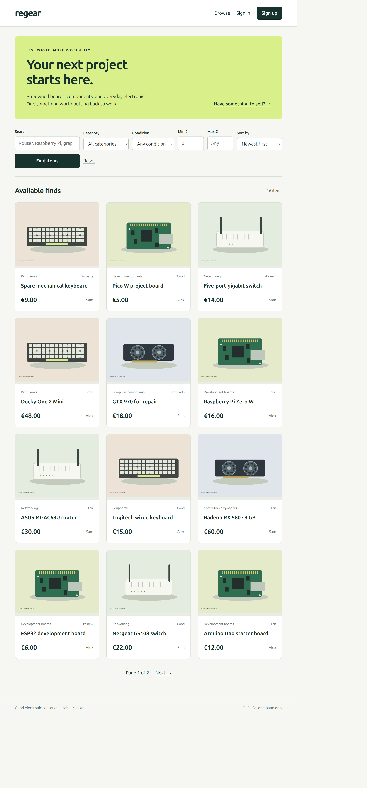
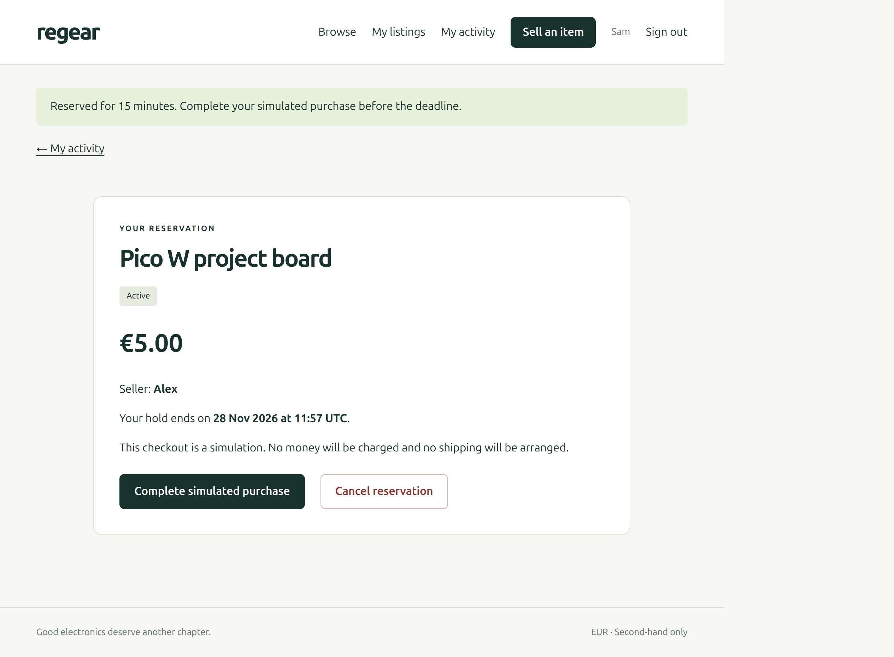
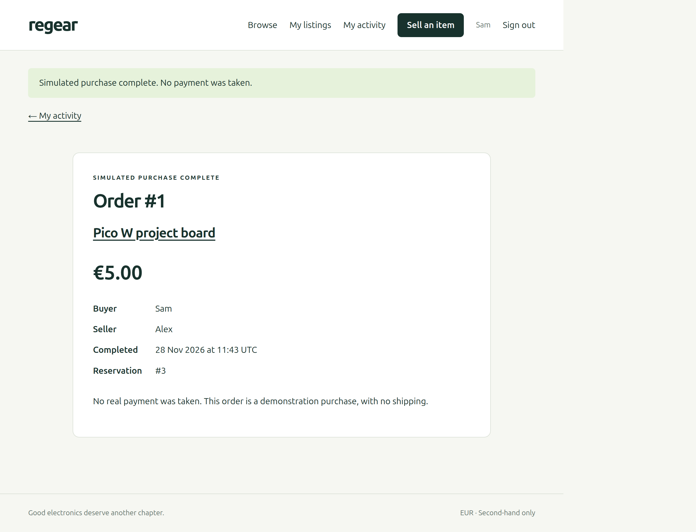

# Regear — second-hand electronics

A Rails marketplace for used routers, development boards, computer components and peripherals. Sellers publish one physical item per listing; buyers reserve it for 15 minutes and complete a simulated purchase.



## Run the demo with Docker Compose

Requires Docker with Compose v2. From the repository root:

```sh
docker compose up --build -d --wait
```

Open <http://localhost:3000>. The setup container prepares MySQL and seeds 16 listings before web and Sidekiq start. Images are labelled demo illustrations. MySQL, Redis and uploaded images persist in named volumes. The application image includes the source; after editing it, rerun the command with `--build`.

| Account | Email | Password |
| --- | --- | --- |
| Alex | alex@example.com | Regear-demo-2026! |
| Sam | sam@example.com | Regear-demo-2026! |

These credentials and the database passwords are for a local demonstration. Compose runs Rails in development and binds published ports to localhost. This is not a production deployment configuration; the separate [production Dockerfile](Dockerfile) requires production credentials and infrastructure.

```sh
docker compose logs -f web worker
docker compose stop worker
docker compose start worker
docker compose exec web bin/rails reservations:expire_overdue
docker compose down
```

Stopping services preserves data. Do not add `--volumes` to `down` unless you intend to delete the database and photos. If Docker reports socket permission denied, configure your user's Docker access or run the Docker commands with `sudo`.

## Example workflows

1. Sign in as Alex, open **My listings**, and create or edit an available item with a photo, condition and EUR price.
2. Sign out and sign in as Sam. Search for Alex's item, open its details and reserve it. The reservation captures the price and holds the item for 15 minutes.
3. Complete the simulated purchase. Open **My activity** to see the purchase and order. Sign back in as Alex to see the same order under sales.
4. Reserve another item and cancel it; it becomes available again. To demonstrate expiry, leave a reservation for 15 minutes. Checkout rejects it after the deadline even if the worker is stopped.

A seller cannot reserve their own item. Only its seller can edit or remove an eligible listing. Reserved and sold listings cannot be edited, and reservation/purchase history prevents deletion. Repeated checkout returns the original order.





It shows browsing, filtering, reservation, cancellation, simulated checkout and the seller's sales history. The recording uses demo accounts and does not process money.

## Native Ruby setup

Versions: Ruby **3.4.13**, Rails **8.1.4.1**, Bundler **4.1.1**, MySQL **8.4**, Redis **7.4**, Sidekiq **8.1.7**. Ruby is recorded in [.ruby-version](.ruby-version); dependencies are pinned in [Gemfile.lock](Gemfile.lock). Use the [Rails 8.1 guides](https://guides.rubyonrails.org/v8.1/).

Install the recorded Ruby version, a compiler, MySQL client development headers and libvips. With mise, run `mise install` and prefix Ruby commands with `mise exec --` if needed.

```sh
bundle install
docker compose up -d --wait mysql redis
bin/rails db:prepare
bin/rails db:seed
bin/rails server
```

Run `bin/jobs` in another terminal. Do not run the native server and Compose web on port 3000 simultaneously.

| Setting | Native default | Compose app |
| --- | --- | --- |
| DB_HOST | 127.0.0.1 | mysql |
| DB_PORT | 3307 | 3306 |
| DB_USERNAME | regear | regear |
| DB_PASSWORD | local_app_password | local_app_password |
| REDIS_URL | redis://127.0.0.1:6380/0 | redis://redis:6379/0 |
| RAILS_MAX_THREADS | 5 | 5 |

The MySQL initialization script creates `regear_test` alongside `regear_development`. Initialization only runs on an empty volume. For an older volume missing the test database:

```sh
docker compose exec -T mysql sh -c 'MYSQL_PWD="$MYSQL_ROOT_PASSWORD" mysql -uroot' < db/docker-init/01-test-database.sql
```

`/up` checks Rails startup, not database or worker health. To verify persistence, run `bin/rails console`:

```ruby
ActiveRecord::Base.connection.select_value("SELECT VERSION()")
category = Category.create!(name: "Console check", slug: "console-check")
Category.find_by!(slug: "console-check").name
category.destroy!
```

## Engineering decisions

### MySQL owns reservation state

Listings, reservations and orders must change together. MySQL transactions make those writes atomic and durable. Redis only stores background jobs; a Redis outage cannot change an agreed price, erase an order or extend a reservation. Money is stored as integer cents, with EUR as the only supported currency.

Foreign keys protect relationships, required columns reject incomplete records, and check constraints protect prices, currencies and states. Unique indexes on order listing and reservation IDs prevent duplicate purchases. A unique generated `active_listing_id` permits at most one active reservation per listing while retaining historical reservations.

### Simultaneous buyers take the same listing lock

Reserve, cancel, expire and checkout all lock the listing before inspecting or changing its state. The first buyer reserves and commits; the next buyer obtains the lock, sees the reserved state and is rejected. The reservation captures its agreed price inside that transaction. Checkout creates one order and marks the reservation completed and listing sold atomically; a repeat returns that order.

Ruby enforces ownership and allowed transitions. The database provides locking, rollback and constraint enforcement. Constraints alone do not enforce the whole cross-table state machine: every mutation must continue using the common locking convention.

### Expiration remains correct when a worker runs late

Checkout compares `expires_at` with the current time after acquiring the listing lock. The timestamp determines validity, not whether an expiration job has run. Expiration reloads the reservation under the same lock and acts only when it is still active and overdue. Repeated or old jobs cannot release a newer reservation.

Jobs enqueue after commit, so rolled-back reservations do not create jobs. MySQL and Redis do not share a transaction: the application can crash after committing but before enqueueing. Known enqueue failures are logged and reported. New reservation attempts can release overdue holds under the lock; the recovery command also works without Redis:

```sh
bin/rails reservations:expire_overdue
```

For ongoing operation, schedule this command once per minute using the host scheduler, or its Compose equivalent above. This repository does not install a recurring schedule. Stop Sidekiq with SIGTERM or Ctrl-C for graceful shutdown; Compose allows 30 seconds. Redis uses append-only persistence and `noeviction`.

See [Sidekiq's idempotency guidance](https://github.com/sidekiq/sidekiq/wiki/Best-Practices) and [Compose startup ordering](https://docs.docker.com/compose/how-tos/startup-order/).

### Listing queries stay bounded

Browse and My listings preload sellers, categories, photo attachments and blobs. Loading each seller inside the rendering loop would cause an N+1 query problem: one listing query followed by a seller query per item. Regression tests compare one listing with twelve distinct listings and verify the query count stays constant. Pagination loads only twelve records per page.

## Verification

```sh
bin/rails db:test:prepare
PARALLEL_WORKERS=1 bin/rails test
bin/rails zeitwerk:check
bin/rubocop
bin/brakeman --quiet --no-pager --exit-on-warn --exit-on-error
bin/bundler-audit check --update
bin/importmap audit
```

For the containerized app, prefix each command with `docker compose exec web`; prepare the test database with `docker compose exec web bin/rails db:test:prepare`.

Tests run against MySQL, including concurrency tests with independently verified database connections. One test worker avoids needing extra per-worker databases. The test job adapter isolates most tests from Redis.

| Scenario | Expected result |
| --- | --- |
| Edit another seller's listing | Rejected, including forged requests |
| Reserve your own listing | Rejected |
| Two buyers reserve simultaneously | Exactly one reservation succeeds |
| Checkout an expired reservation | Rejected; item released |
| Checkout twice, including concurrently | One order; same order returned |
| Expiration runs twice | No additional changes |
| Old expiration runs after a new reservation | New reservation remains active |
| Negative price, including direct database writes | Rejected |
| More listings on the page | Query count stays constant |

[GitHub Actions](.github/workflows/ci.yml) runs MySQL tests, autoload checks, RuboCop, Brakeman, dependency audits, and a full Compose build/start smoke test. Ruby setup follows the [official setup-ruby action](https://github.com/ruby/setup-ruby). Hosted CI results become available after pushing.

